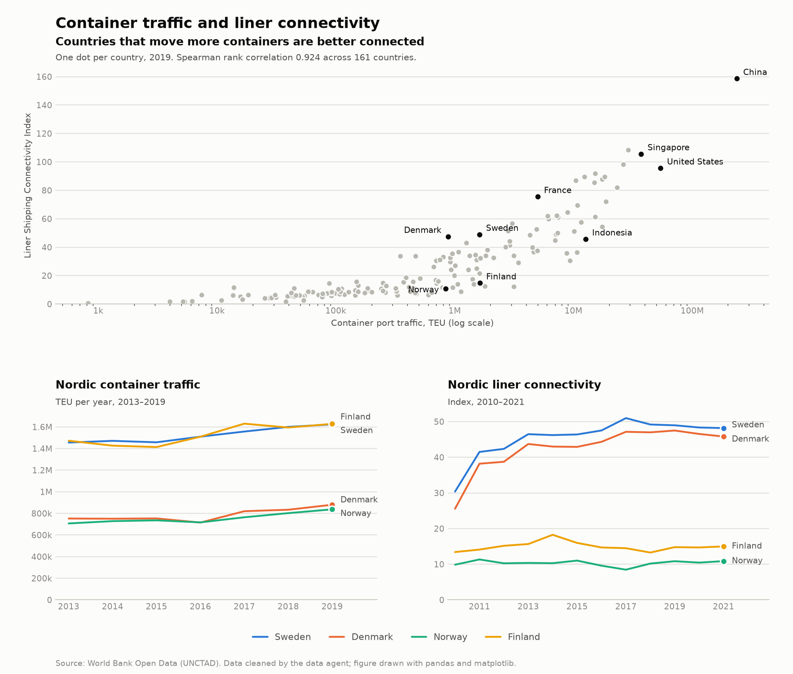

# Maritime data agents

A small pipeline in which three AI agents prepare, analyse and report on public
maritime data, and every figure they produce is checked independently before it
reaches the final brief.

**Data:** container port traffic (TEU) and the Liner Shipping Connectivity Index by
country, from World Bank Open Data (original source: UNCTAD).

## How it works

```
data agent  ->  analyst agent  ->  validation (pandas)  ->  writer agent
                     ^                   |
                     +--- retry if any figure fails the check
```

| Step | Who | What it does |
| --- | --- | --- |
| 1 | Data agent | Downloads each indicator, inspects its quality and chooses the cleaning rules |
| 2 | Analyst agent | Answers the question using analysis tools and submits findings with their figures |
| 3 | Validation | Plain pandas recomputes the figure behind each finding; wrong findings go back to the analyst |
| 4 | Writer agent | Turns the verified findings into a short policy brief |

The agents cannot run arbitrary code. They can only call the functions in
`tools.py`, and everything they do is saved in `runs/` so each run can be audited
(the logs stay on the machine that runs the pipeline; they are not in this repository).

Three kinds of figure can be checked: a value in a year, a percentage change between
two years, and the Spearman rank correlation between the two indicators in a year.
If the analyst answers in prose instead of submitting structured findings, the
orchestrator reminds it and continues.

## Files

- `config.py`: model, indicators, question and tolerances
- `tools.py`: the functions the agents may call, and their schemas
- `agents.py`: the agent loop and the three agents' instructions
- `validate.py`: the independent check
- `orchestrator.py`: runs the whole pipeline
- `dashboard.py`: draws `outputs/dashboard.png` from the cleaned data (no AI involved)
- `tests/`: tests for the validation step (no API key needed)
- `outputs/`: the results of the final run
- `data/`: empty here; the pipeline downloads the data and writes `raw.csv` and `clean.csv`

## Setup

1. Install Python 3.10 or later, then: `pip install -r requirements.txt`
2. Create an API key in the Claude Console and copy `.env.example` to `.env` with your key.
3. Run the tests: `pytest`
4. Run the pipeline: `python orchestrator.py`
5. Draw the dashboard: `python dashboard.py` (it needs the `data/clean.csv` that step 4 creates)

On Windows, use `py` instead of `python`, and `py -m pip` and `py -m pytest`.

Outputs appear in `outputs/`: `brief.md`, `validation_report.md`, `findings.json` and
`dashboard.png`.

## Results

Final run: 4 October 2026, Claude Sonnet 5.5. The brief is in `outputs/brief.md` and the
check of every finding in `outputs/validation_report.md`.



The figure is drawn by `dashboard.py` with pandas and matplotlib, straight from
`data/clean.csv`. It does not use the agents, so it is a second way to check the brief:
the correlation in its title is computed again from the data.

### What the brief concluded

- China leads both indicators in 2019: 237.6 million TEU and a connectivity index of 158.6.
- The two indicators are closely aligned: Spearman rank correlation of 0.924 across
  161 countries in 2019, the latest year with data for both.
- Among countries starting from at least 500,000 TEU, Qatar's traffic grew fastest between
  2015 and 2019 (+135.9%) and Venezuela's fell the most (-56.7%).
- Among countries starting from an index of at least 10, Qatar's connectivity grew fastest
  (+225.3%) and Bahrain's fell the most (-56.6%).
- Sweden is the best connected Nordic country (48.96). Finland moves about as much
  container traffic as Sweden but its index is only 14.79.
- Indonesia ranks much better on traffic than on connectivity; France is the opposite.

### How the agents performed

| Run | Model | Findings verified, round 1 | Retries | Errors found in the separate review |
| --- | --- | --- | --- | --- |
| 1, before the fixes below | Haiku 4.5 | 7 of 8 | 1 | 2 wrong statements (see below) |
| 2, after the fixes | Haiku 4.5 | 12 of 12 | 0 | none; 2 percentages truncated instead of rounded |
| 3, final | Sonnet 5.5 | 11 of 11 | 0 | none |

After each run, every figure in the brief was compared with `data/clean.csv` in a
separate review, including the figures the automatic validation does not cover.

### What the validation caught, and what it missed

- **Caught, wrongly.** In run 1 it rejected -1.3 against -1.33. That was rounding, not an
  error: a relative tolerance alone is too strict for small percentages.
- **Missed.** The brief of run 1 said Japan ranked 12th in connectivity with 76.7. That
  value is from 2015; in 2021 Japan ranked 17th with 69.7. One finding also placed Belgium
  outside the top 15 for traffic when it was 15th. Both passed, because the validation
  checked one figure per finding and did not check ranks.
- **Format failure.** In an earlier run the analyst answered in prose instead of calling
  the submission tool, and the pipeline stopped.
- **Invented labels.** The data agent made up names for the indicators, because it only
  received their codes.
- **Misleading growth rates.** Run 1 highlighted Iraq (+756%) and Greenland (+150%), which
  start from very small values.

### What I changed as a result

- An absolute tolerance of 0.05 percentage points for growth rates.
- The analyst must put exactly one figure in each finding, and the writer may only quote
  that figure.
- The analyst must set a minimum starting value when it reports growth.
- The data agent receives the official name of each indicator.
- A reminder loop when an agent does not use the submission tool.

### Known limitations

- Only the figure in `number` is checked. In run 2 the analyst still put several figures
  in 5 of 12 findings; they were correct, but the validation did not check them.
- Ranks and words such as "fastest" or "the most" are not checked automatically.
- The data agent kept traffic up to 2019 and connectivity up to 2021, so comparisons
  between the two indicators stop in 2019.
- These are three runs. They show how the pipeline behaves, not a measured error rate.

## About

I built this project to learn how to orchestrate AI agents and, above all, how to check
their work. The starting skeleton was written with the help of Claude.
I added the second indicator and the correlation metric, ran and reviewed the pipeline,
and worked through the fixes listed above.

Marc Far Ruiz · [LinkedIn](https://www.linkedin.com/in/marc-far/)
